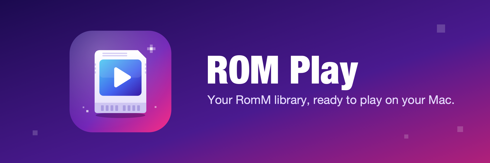

<p align="center">
  
</p>

<p align="center">
  
  <a href="https://romm.app"></a>
  <a href="LICENSE"></a>
</p>

**ROM Play is an emulator front end for the Mac.** It plays the games in your [RomM](https://romm.app) library, from the Atari 2600 to the PlayStation 4, Switch and PS Vita, each in its own emulator.

ROM Play is based on [RomP](https://github.com/RompEmu/RomP) by Beshr Kayali Reinholdsson, an open-source RomM player, and builds on it with more systems and features. All credit for RomP goes to its author and contributors. ROM Play isn't affiliated with or endorsed by the RomP project.

## Getting ROM Play

You need a Mac with Apple Silicon and a [RomM](https://romm.app) server, version 5.0 or newer.

1. Download the latest `.dmg` from [Releases](https://github.com/afsrq/ROM-Play/releases/latest).
2. Open it and drag **ROM Play** to Applications.
3. ROM Play isn't notarized by Apple, so macOS blocks it the first time. Open it once, then go to System Settings → Privacy & Security and choose **Open Anyway**.
4. Sign in with your RomM server's address and your RomM account.

From then on, ROM Play keeps itself up to date.

## What ROM Play adds to RomP

- **More systems:** PlayStation 4 with [shadPS4](https://github.com/shadps4-emu/shadPS4), Nintendo Switch with [Ryubing](https://git.ryujinx.app/projects/Ryubing), Nintendo 3DS with [Azahar](https://github.com/azahar-emu/azahar) and PS Vita with [Vita3K](https://github.com/Vita3K/Vita3K). ROM Play installs each one and keeps it apart from any copy you installed yourself.
- **TV mode:** a full-screen layout for playing on a TV with a controller. Consoles and collections run along the top, the box art is big, and games start full screen. The View/Select button switches it on and off.
- **Games outside RomM:** the **+** button in the sidebar adds a Mac app, such as a recompiled port of a console game, or a ROM file you have on your Mac. Each one goes under its console, including the Switch and Switch 2, and can borrow its cover and details from the same game in your RomM library. Mac apps open as themselves, ROM files play with ROM Play's emulators, and play time is kept for both. Removing one takes it out of ROM Play and leaves the files alone.
- **Updates itself:** ROM Play downloads new versions in the background, checks them, and installs them when you restart or quit.
- **Emulators that stay up to date:** before a game starts, ROM Play checks for a newer release of its standalone emulators (shadPS4, RPCS3, xemu and Vita3K) and installs it. If you're offline, or an update fails, it plays with the version it already has.
- **PS4 settings:** Settings → Consoles → **shadPS4 settings** opens the [shadPS4 QtLauncher](https://github.com/shadps4-emu/shadps4-qtlauncher) for ROM Play's copy of shadPS4, for graphics, controls, patches and more.
- **Its own app:** ROM Play keeps its settings, sign-ins and downloads apart from RomP's, so you can have both installed.

## Features

- **Your RomM library:** platforms, favorites, collections, recently played, now playing and backlog, with search, sorting, a Surprise me button for a random game, and box art shaped like each console's.
- **One click to play:** ROM Play installs the right emulator and BIOS files. Downloaded games play offline.
- **Saves that follow you:** in-game saves and save states sync with RomM before and after you play. If both sides changed, you choose which to keep.
- **Sandboxed emulators:** emulators are native code downloaded from the internet, and games are files from anywhere. Each game runs in its own locked-down process that can only write to that game's saves and its own temporary files, so a buggy or malicious emulator or ROM can't touch your other files or take ROM Play down with it. xemu, RPCS3 and shadPS4 run outside the sandbox.
- **RetroAchievements:** earn achievements as you play, with popups, leaderboards, and an achievement list in the game menu and on each game's page. Hardcore mode comes once RetroAchievements approves ROM Play, which it considers after an emulator has been public for six months. Only the app talks to RetroAchievements, never the sandboxed emulator.
- **Many systems:** from the Atari 2600 to the PS4, PS3 and original Xbox, plus arcade and home computers. See [supported systems](#supported-systems).
- **Controllers and multiplayer:** gamepads join as the next player, rumble when the game does, any key or button can be remapped, and the whole app works with a controller.
- **Light guns, mice and keyboards:** for the systems that use them.
- **In-game menu:** pause, restart, save slots, changing discs, volume and full screen, from the Guide button or Esc.
- **Two-screen Nintendo DS and 3DS:** a window per screen, with the mouse as the touch pen.
- **Picks up where you left off:** the last console, game and scroll position, and the size and position of every window.
- **Interface sizes:** 1x, 1.5x or 2x.

## Supported systems

ROM Play downloads the emulator for each system the first time you play one of its games.

| System | Emulator |
|---|---|
| Arcade, including Neo Geo and CPS 1–3 | FinalBurn Neo |
| Amstrad CPC | Caprice32 |
| Atari 2600 | Stella |
| Atari 5200 | a5200 |
| Atari 7800 | ProSystem |
| Atari 8-bit computers and XEGS | Atari800 |
| Atari Jaguar and Jaguar CD | Virtual Jaguar |
| Atari Lynx | Beetle Lynx |
| Atari ST | Hatari |
| Bandai WonderSwan and WonderSwan Color | Beetle WonderSwan |
| ColecoVision | Gearcoleco |
| Commodore 64 | VICE x64sc |
| Commodore 128 | VICE x128 |
| Commodore VIC-20 | VICE xvic |
| Commodore Plus/4 and 16 | VICE xplus4 |
| Commodore Amiga, Amiga CD32 and CDTV | PUAE |
| DOS | DOSBox Pure |
| Fairchild Channel F | FreeChaF |
| Intellivision | FreeIntv |
| Magnavox Odyssey 2 | O2EM |
| Mega Duck / Cougar Boy | SameDuck |
| MSX, MSX2 and MSX2+ | blueMSX |
| NEC PC Engine / TurboGrafx-16 | Beetle PCE Fast |
| NEC PC Engine CD / TurboGrafx-CD | Beetle PCE |
| NEC SuperGrafx | Beetle SuperGrafx |
| NEC PC-FX | Beetle PC-FX |
| Nintendo Entertainment System, Famicom and Famicom Disk System | Nestopia UE |
| Super Nintendo and Super Famicom | Snes9x |
| Nintendo 64 | Mupen64Plus-Next |
| Game Boy, Game Boy Color and Game Boy Advance | mGBA |
| Nintendo DS | melonDS DS |
| Nintendo 3DS and New 3DS | [Azahar](https://github.com/azahar-emu/azahar), which carries on Citra |
| Nintendo GameCube and Wii | Dolphin |
| Nintendo Virtual Boy | Beetle VB |
| Nintendo Game & Watch | Game & Watch |
| Nintendo Pokémon Mini | PokeMini |
| Philips CD-i | SAME CDi |
| 3DO | Opera |
| Sega Master System, Genesis / Mega Drive, Game Gear, Sega CD and SG-1000 | Genesis Plus GX |
| Sega 32X | PicoDrive |
| Sega Saturn | Beetle Saturn |
| Sega Dreamcast | Flycast |
| SNK Neo Geo CD | NeoCD |
| SNK Neo Geo Pocket and Pocket Color | Beetle NeoPop |
| Sony PlayStation | Beetle PSX HW |
| Sony PlayStation 2 | [ARMSX2](https://github.com/RompEmu/ARMSX2) |
| Sony PlayStation 3 | RPCS3 |
| Sony PlayStation 4 | [shadPS4](https://github.com/shadps4-emu/shadPS4), on macOS 26 or newer, through Rosetta 2 |
| Sony PSP | PPSSPP |
| Sony PS Vita | [Vita3K](https://github.com/Vita3K/Vita3K) |
| PICO-8 | [FAKE-08](https://github.com/RompEmu/fake-08) |
| TIC-80 | TIC-80 |
| Vectrex | Vecx |
| Watara Supervision | Potator |
| Nintendo Switch | [Ryubing](https://git.ryujinx.app/projects/Ryubing), the continuation of Ryujinx |
| Microsoft Xbox | xemu |
| ZX Spectrum | Fuse |

All emulators except xemu, RPCS3, shadPS4, Ryubing and Vita3K are [libretro](https://www.libretro.com) cores. ARMSX2 and FAKE-08 come from RompEmu's own forks, and Azahar from Azahar's own releases, checked against the checksums GitHub publishes. Dolphin, PPSSPP, Flycast, Beetle PSX HW, Mupen64Plus-Next, ARMSX2 and Azahar draw through Vulkan, using the bundled [MoltenVK](https://github.com/KhronosGroup/MoltenVK). Most of them fall back to OpenGL if Vulkan isn't working.

### What some systems need

Some systems need BIOS files or system software. ROM Play takes these from the firmware in your RomM server, so add them there first.

- **PlayStation 3:** the PS3 system software (`PS3UPDAT.PUP`) in RomM's PS3 firmware. Games play from a game folder or an ISO, or a zip or 7z of one.
- **PlayStation 4:** games play from an installed game folder with an `eboot.bin`, or a zip or 7z of one. `.pkg` files aren't supported. How well a game runs depends on the game and the Mac: see [shadPS4's compatibility list](https://github.com/shadps4-compatibility/shadps4-game-compatibility).
- **Nintendo Switch:** the keys from your own Switch (`prod.keys`, and `title.keys` if you have it) in RomM's Switch firmware. If a Switch firmware `.zip` is there too, Ryubing installs it the first time. Games play from an `.nsp` or `.xci`, or a zip or 7z of one. Ryubing publishes no checksums, so ROM Play installs only the build it was released with, checked against its own copy of that build's checksum.
- **Nintendo 3DS:** games must be decrypted, as Azahar plays only those.
- **PS Vita:** the Vita system software (`PSVUPDAT.PUP`, and the font package `PSP2UPDAT.PUP` if you have it) in RomM's PS Vita firmware, which ROM Play installs into Vita3K the first time. Games play from a `.vpk`, a `.zip`, a game folder, or a 7z of one. The first time, Vita3K installs the game; after that it starts straight away. Encrypted `.pkg` files aren't supported.

## Building

Requires [rustup](https://rustup.rs) and CMake.

```sh
cargo build --release
./target/release/romp
```

If the folder you build in has a space in its path, one of the dependencies (SDL3) fails to link. Build somewhere else with `CARGO_TARGET_DIR`, for example `CARGO_TARGET_DIR=~/Library/Caches/rom-play/target cargo build --release`; `make` picks it up too.

`make dist` packages the app into `dist/`: `ROM Play.app`, a zip and a disk image. `make check` runs the same checks as CI: formatting, Clippy, tests, [cargo-deny](https://github.com/EmbarkStudios/cargo-deny), [typos](https://github.com/crate-ci/typos), [actionlint](https://github.com/rhysd/actionlint) and [zizmor](https://github.com/zizmorcore/zizmor).

The icon is drawn from `packaging/icon/icon.svg`. After changing it, run `sh packaging/icon/render.sh` on a Mac to redraw every icon and the banner.

## License

ROM Play is free software under the [GNU General Public License, version 3 or later](LICENSE), like RomP, which it is based on. The emulators it downloads have their own licenses, listed in the app under About → Licenses.
